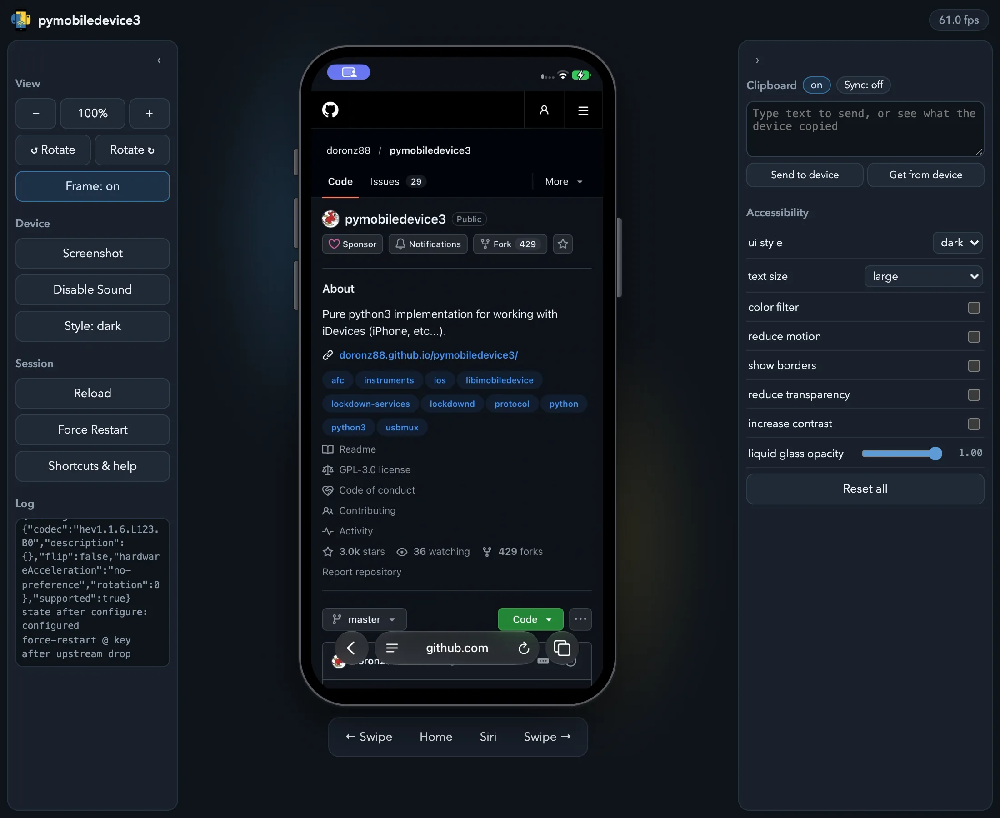

# Mirroring and Controlling the Screen

pymobiledevice3 can show a device's screen live and let you use it from your computer: tap, swipe,
type, press the hardware buttons, hear its audio and share the clipboard. There are two viewers:

- **`serve-web`**: the screen in any modern browser, on macOS, Linux or Windows, with nothing else
  to install.
- **`serve-vnc`**: a VNC server for macOS Screen Sharing or any VNC client (macOS hosts only).

Both use the same live video stream Xcode's device window uses, sent by the device itself over the
iOS 17+ tunnel that pymobiledevice3 sets up for you.

## Requirements

- **iOS 27 or later.** Older versions don't send the stream, so both commands refuse to start.
- **Developer Mode** turned on and the **DeveloperDiskImage mounted**
  (`pymobiledevice3 mounter auto-mount`; see [Developer Mode and DDI](cli-recipes.md#developer-mode-and-ddi)).
- No foreground app using the camera or microphone (see [below](#camera-and-microphone)).

## In the browser: `serve-web`

```shell
pymobiledevice3 developer core-device display serve-web
```

Open <http://127.0.0.1:8080/>. The device appears inside a phone frame, live:



- **Touch**: click to tap, drag to swipe.
- **Hardware buttons** are drawn on the edges of the frame; click them. The bar under the device
  adds Home, Siri and left/right swipes.
- **Keyboard**: type into the page and the text goes to the device.
- **Sound** plays in the browser (`--no-audio` starts muted; *Enable Sound* turns it back on).
- **View** panel: zoom (`Ctrl+=` / `Ctrl+-` / `Ctrl+0`) and rotate the displayed device.
- **Screenshot** (`Ctrl+P`) saves the current frame as a PNG.
- **Shortcuts & help** (`?`) lists every keyboard shortcut.
- **Style** and the **Accessibility** panel switch light/dark mode, text size, color filters,
  reduce motion, increase contrast and similar settings, like Xcode's environment overrides. They
  change the device's real settings and stay changed after you close the viewer; *Reset all* puts
  the accessibility settings back to their defaults.
- **Clipboard** panel: turn on **Sync**, and text and images copied on the device land in your
  computer's clipboard, while whatever you copied on the computer is on the device by the time you
  paste. Pictures copied out of a rich-text app such as Notes are not shared (copy them from Photos
  instead). The browser only allows clipboard access on `localhost` or with `--https`, asks for
  permission once, and holds device copies made while the tab is in the background until you return.

Video is decoded in the browser itself (WebCodecs), which is why nothing needs to be installed on
the viewing machine.

### Sharing with other machines

By default the viewer only listens on this computer. To reach it from the rest of the network, bind
every interface and **set a password**, because whoever reaches the port can both watch and control
the device:

```shell
pymobiledevice3 developer core-device display serve-web --bind 0.0.0.0 --password 'CHOOSE_ONE' --https
```

`--https` is needed when viewing from another machine: browsers only allow the in-browser video
decoder on `localhost` or over HTTPS. The certificate is self-signed, so the browser warns once;
accept it and the viewer works normally.

## With a VNC client: `serve-vnc` (macOS)

```shell
pymobiledevice3 developer core-device display serve-vnc
```

Then connect to `vnc://127.0.0.1:5901`, for example from Finder with ⌘K, which opens macOS Screen
Sharing. This viewer is macOS-only because it decodes the video on the host with VideoToolbox.

| In the VNC client | On the device |
| --- | --- |
| Click / drag | Tap / swipe |
| Right-click | Home |
| `Ctrl+H` / `Ctrl+L` | Home / Lock |
| `Ctrl+[` / `Ctrl+]` | Volume down / up |
| `Ctrl+\` | Mute |
| `Ctrl+S` | Siri |

Useful options:

- `--audio` plays the device's sound through the Mac's speakers.
- `--share-clipboard` shares text (VNC has no image clipboard). It follows the VNC client's own
  clipboard setting; clients with the Extended Clipboard extension (TigerVNC, noVNC, ...) get full
  UTF-8.
- `--bind 0.0.0.0 --password 'CHOOSE_ONE'` makes it reachable from other machines, with the same
  warning as above.

## Devices with several displays

On a device with more than one built-in display, such as a foldable iPhone, both viewers show the
display in use, and touches go to that display. `serve-web` follows the device as it is folded or
unfolded: the browser switches to the other display by itself, and shows an unfolded device in
landscape when it is held that way.

To show one display regardless, pass its `displayId` from `get-display-info`:

```shell
pymobiledevice3 developer core-device get-display-info
pymobiledevice3 developer core-device display serve-web --display-id 2
```

`monitor-display-info` prints the display information again each time it changes. The touch commands
of `universal-hid-service` (`tap`, `drag`, ...) also act on the display in use; `--touch-service-id`
picks another display's touchscreen, as listed by `universal-hid-service list-connected`.

## Camera and microphone

iOS won't start a mirroring session while a foreground app is using the camera or microphone; Xcode
has the same restriction. If **Camera**, **Voice Memos** or a similar app is in front, the command
explains this in one line and exits. Quit that app and run it again. While mirroring is running,
those apps can't use the sensors and record silence or black video, so stop mirroring before
recording with them.

## Raw stream capture

For analysis or archiving, the stream can be saved as it arrives:

```shell
# Capture 10 seconds of the raw RTP/HEVC packets
pymobiledevice3 developer core-device display start-video-stream /tmp/cap.rtp --duration 10

# In a source checkout: convert to an .h265 file that ffplay or VLC can play
misc/rtp_dump.py /tmp/cap.rtp /tmp/cap.h265
ffplay -framerate 60 /tmp/cap.h265
```

`start-audio-stream` does the same for the device's sound.
